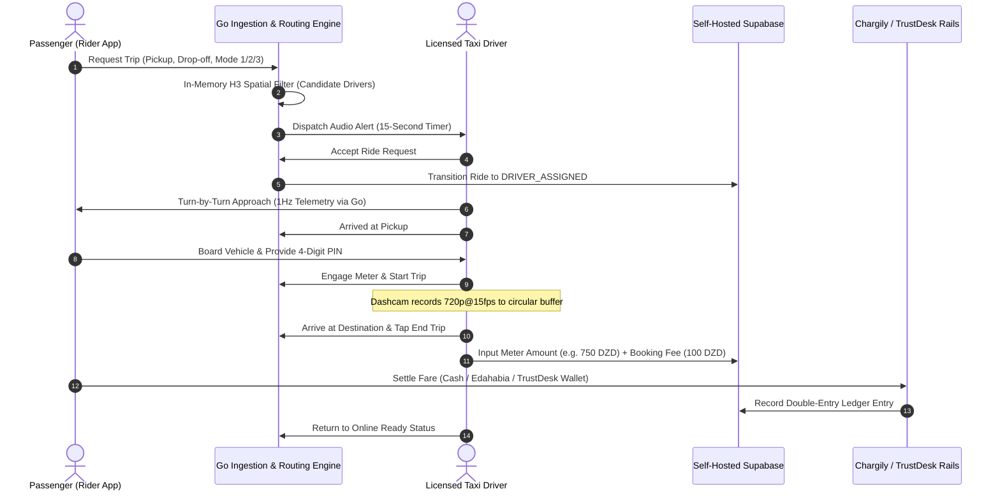

# Algeria Smart Taxi & Mobility Platform
## Master Technical Architecture, Schema, and Implementation Specification
### Prepared for System Architecture Review and Technical Collaboration

---

## 1. Executive Strategy and Regulatory Moat

### 1.1 The Regulatory Impasse in Algeria
The Algerian passenger transport market is characterized by severe operational friction. Existing ride-hailing platforms (including Yassir, Heetch, Coursa, and InDrive) operate as IT intermediary services using private civilian vehicles. This exposes drivers to vehicle impoundment (*mise en fourrière*) for 15 to 45 days during routine police and gendarmerie highway checkpoints, while creating persistent conflict with licensed taxi syndicates.

### 1.2 The Regulated Fleet Model
This platform turns Algerian transport law into a defensible barrier to entry. The platform onboarded fleet consists exclusively of drivers possessing valid municipal transport permits (*Agrément de Transport*) and professional aptitude cards (*Livret de Place*) issued under Executive Decree No. 12-230 (*Décret exécutif n° 12-230 du 24 mai 2012*). 

The platform operates under Algerian Commercial Register activity code CNRC 604103 (*Entreprise de gestion de taxis*), allowing legal operation as a certified taxi dispatch and fleet management organization. This gives drivers full checkpoint immunity, access to dedicated urban transit lanes where available, and access to state-regulated passenger insurance.

---

## 2. Data Sovereignty and Domestic Cloud Infrastructure (Law 18-07 & Law 25-11)

### 2.1 Regulatory Mandate
Algerian Law No. 18-07 and Law No. 25-11 of July 24, 2025 strictly govern the processing and transfer of personal data. Storing sensitive data of Algerian citizens (including continuous 1Hz GPS breadcrumbs, personal identity documents, and cabin video footage) on foreign cloud providers (such as AWS, Google Cloud, or Azure foreign regions) is prohibited without explicit authorization from the National Data Protection Authority (*Autorité Nationale de Protection des Données à Caractère Personnel* - ANPDP).

### 2.2 Domestic Infrastructure Deployment
All core backend components run on domestic Tier-3 cloud data centers in Algeria (such as Algérie Télécom Kouba/Ben Aknoun, ICOSNET, or ISSAL):
- **Core Database & State**: Self-Hosted Supabase cluster (PostgreSQL 16, PostGIS, pgcrypto, pg_h3) deployed on bare-metal or private Kubernetes nodes within Algerian borders.
- **Object Storage**: Local MinIO cluster configured with S3-compatible APIs and distributed erasure coding, providing signed URLs for encrypted dashcam incident video chunks and KYC documentation.
- **Law 25-11 Compliance Pack**:
  - *Data Protection Impact Assessment (AIPD)*: Documented risk assessment covering continuous GPS tracking and in-vehicle video buffering.
  - *Processing Registry*: Maintained catalog of data flows, retention schedules, and role-based access controls filed with the ANPDP.
  - *Breach Protocol*: Automated 5-day breach notification workflow to report security events to the ANPDP and affected data subjects.

```
+-----------------------------------------------------------------------------------+
|               Domestic Algerian Tier-3 Cloud Infrastructure                       |
+-----------------------------------------------------------------------------------+
|                                                                                   |
|  +---------------------------+   +-----------------------+   +-----------------+  |
|  | Self-Hosted Supabase      |   | Local MinIO Cluster   |   | Go Ingestion &  |  |
|  | - PostgreSQL 16 + PostGIS |   | - S3-Compatible API   |   | Routing Engine  |  |
|  | - In-Memory State Cache   |   | - AES-256 Video Vault |   | - Valhalla/OSRM |  |
|  | - RLS Security Policies   |   | - Local Sovereignty   |   | - H3 Grid Res 8 |  |
|  +---------------------------+   +-----------------------+   +-----------------+  |
|                                                                                   |
+-----------------------------------------------------------------------------------+
```

---

## 3. High-Throughput 1Hz Telemetry and Ingestion Architecture

### 3.1 Telemetry Decoupling from PostgreSQL
Streaming 1Hz coordinate updates from thousands of active drivers directly into PostgreSQL creates massive Write-Ahead Log (WAL) bloat, index write amplification, and autovacuum lockups.

The platform decouples high-frequency location streaming from the transactional database:

```
+-----------------------------------------------------------------------------------+
|                          Decoupled Telemetry Pipeline                             |
+-----------------------------------------------------------------------------------+
|                                                                                   |
|  [ Active Drivers (1Hz GPS) ]                                                     |
|                |                                                                  |
|                v (gRPC / Binary Protobuf WebSockets)                              |
|  +-----------------------------------------------------------------------------+  |
|  | Go Geospatial Ingestion Engine                                              |  |
|  | - In-memory spatial index (H3 Resolution 8 / Valkey Geo)                    |  |
|  | - Evaluates real-time driver proximity & distance matrices in sub-15ms      |  |
|  | - Fans out live driver coordinates to subscribed rider WebSockets           |  |
|  +-------------------------------------+---------------------------------------+  |
|                                        |                                          |
|         +------------------------------+-----------------------------+            |
|         | Every 60 Seconds (Batched)                                 | On State   |
|         v                                                            v Change     |
|  +-------------------------------+                         +-------------------+  |
|  | ride_trajectories Table       |                         | rides Table       |  |
|  | - LINESTRINGM with timestamps |                         | - Status update   |  |
|  | - Low-overhead PostGIS GiST   |                         | - Meter readings  |  |
|  +-------------------------------+                         +-------------------+  |
|                                                                                   |
+-----------------------------------------------------------------------------------+
```

### 3.2 Geospatial Grid and Road Snapping
- **H3 Resolution 8**: Drivers are indexed into H3 hexagonal cells (average area: ~0.737 square kilometers, diameter: ~920 meters). Initial candidate filtering executes in memory in O(1) time without database queries.
- **Routing Engine**: Top candidate drivers are routed to the pickup coordinate using a dedicated Go microservice wrapping an Algerian OpenStreetMap (OSM) extract in Valhalla / OSRM, returning real road distances, turn-by-turn geometry, and traffic-aware travel times.

---

## 4. In-Cockpit Dashcam and Thermal Budget Architecture

### 4.1 In-App Integrated Subsystem Rationale
The dashcam is an integrated subsystem within the unified Driver Mobile Application rather than an isolated external project. This architecture ensures that incident video clips are permanently bound to verified trip metadata: Trip ID, driver taxi license number, rider profile, exact GPS coordinates, speed telemetry, and accelerometer readings.

### 4.2 In-Cockpit Thermal Budget and Hardware Encoding
In Algerian summer conditions, windshield glass temperatures regularly exceed 45°C to 48°C. Running 1080p recording at 30fps alongside 60fps MapLibre GL navigation and continuous 4G transmission will overheat mid-range Android chipsets (such as MediaTek Helio or Qualcomm Snapdragon 6-series) within 20 to 30 minutes, causing kernel thermal throttling or camera process termination.

The Tier 1 smartphone dashcam engine enforces a strict thermal budget:
- **Encoding Profile**: 720p (1280x720) at 15 fps encoded via hardware-accelerated H.264 / HEVC using direct Android `MediaCodec` surface input and iOS `AVCaptureMovieFileOutput`. Frames pass directly from the camera sensor to the hardware encoder without crossing the CPU or Flutter UI compositor.
- **Circular Ring Buffer**:
  - Exactly three 60-second video files are maintained in volatile application cache (`chunk_0.mp4`, `chunk_1.mp4`, `chunk_2.mp4`).
  - Total local disk consumption is capped at 60 megabytes.
  - The oldest chunk is unlinked automatically when a new chunk begins writing.
- **Automated Thermal Load Shedding**:
  - The app listens to Android's `PowerManager.OnThermalStatusChangedListener` and iOS `ProcessInfo.thermalState`.
  - *THERMAL_STATUS_NORMAL*: Standard operation (720p @ 15fps video + 60fps map rendering).
  - *THERMAL_STATUS_MODERATE*: MapLibre GL frame rate throttles to 25fps, HUD preview dims, and background sync intervals expand.
  - *THERMAL_STATUS_SEVERE*: Dashcam video capture pauses gracefully, while high-priority GPS location, IMU crash detection, and dispatch channels stay alive.
- **Sensor Shock Triage**:
  - Mobile accelerometer and gyroscope data are sampled continuously at 50Hz.
  - A digital Butterworth filter isolates vehicle collisions or emergency deceleration (>2.5G net acceleration).
  - An incident locks the current 60s chunk, preceding 60s chunk, and subsequent 30s chunk, burning an on-screen watermark (timestamp, coordinates, speed, trip ID), generating a SHA-256 hash, and uploading an AES-256-GCM encrypted package to local MinIO storage.

---

## 5. Legal Algerian Taxi Modes and Fare Modeling

To avoid legal disputes between estimated app fares and regulated tariffs under Executive Decree No. 12-230, the system supports three legal transport modes:

```
+-----------------------------------------------------------------------------------+
|                        Three Regulated Service Modes                              |
+-------------------+-------------------------------+-------------------------------+
| Mode 1: Taxi      | Mode 2: Taxi Collectif        | Mode 3: Taxi Collectif        |
| Individuel        | Urbain                        | Inter-Wilayas                 |
+-------------------+-------------------------------+-------------------------------+
| - Calibrated      | - Fixed municipal routes      | - Station-to-station routes   |
|   physical meter  | - Regulated flat fare per     |   (Gare routière)             |
| - Regulated       |   seat                        | - Regulated per-seat fare     |
|   booking fee     | - Dynamic seat booking        | - Multi-passenger seat ledger |
|   (Frais approche)|   (1 to 4 seats)              |   (ride_seats state machine)  |
| - Drop-off meter  | - Corridor waypoint           | - Inter-city highway          |
|   photo / OCR     |   optimizations               |   corridors (e.g. Alger-Oran) |
+-------------------+-------------------------------+-------------------------------+
```

### 5.1 Mode 1: Individual Urban Taxi (Taxi Individuel)
- Operates under the physical taximeter installed in the vehicle.
- The total passenger fare equals: $\text{Physical Taximeter Reading} + \text{Regulated Booking Fee (Frais d'approche)}$.
- The booking fee is authorized under Commercial Register code CNRC 604103.
- Upon drop-off, the driver enters the exact meter reading into the app and takes an optional photo verified by client-side OCR.

### 5.2 Mode 2 & 3: Multi-Passenger Collective Seat Ledger
- Urban collective and inter-wilaya taxis charge per seat.
- Rather than a 1-to-1 driver-to-rider lock, rides are modeled as a multi-passenger capacity state machine tracking `total_seats_allocated` and `available_seats`.
- Individual seat reservations are managed in a dedicated `ride_seats` ledger, allowing passenger boarding and drop-off at distinct corridor waypoints.

---

## 6. Complete PostgreSQL DDL Schema and Security Model

```sql
-- Enable Core Database Extensions
CREATE EXTENSION IF NOT EXISTS "uuid-ossp";
CREATE EXTENSION IF NOT EXISTS "postgis";
CREATE EXTENSION IF NOT EXISTS "pgcrypto";

-- ============================================================================
-- ENUM TYPES DEFINITION
-- ============================================================================

CREATE TYPE user_role AS ENUM (
    'rider',
    'driver',
    'fleet_manager',
    'dispatcher',
    'compliance_admin'
);

CREATE TYPE kyc_status_type AS ENUM (
    'unverified',
    'pending_review',
    'verified',
    'rejected',
    'suspended'
);

CREATE TYPE vehicle_category AS ENUM (
    'taxi_urbain',
    'taxi_collectif',
    'vtc_confort',
    'inter_wilaya'
);

CREATE TYPE ride_service_type AS ENUM (
    'taxi_individuel_metered',     -- Mode 1: Taximeter + frais d'approche (CNRC 604103)
    'taxi_collectif_urbain',       -- Mode 2: Urban collective line, per-seat fare
    'taxi_collectif_inter_wilayas' -- Mode 3: Inter-wilaya station-to-station, per-seat fare
);

CREATE TYPE ride_status AS ENUM (
    'requested',
    'matching',
    'driver_assigned',
    'driver_arrived',
    'in_progress',
    'completed',
    'cancelled_by_rider',
    'cancelled_by_driver',
    'disputed'
);

CREATE TYPE payment_rail AS ENUM (
    'cash',
    'edahabia',
    'cib',
    'trustdesk_wallet'
);

CREATE TYPE payment_state AS ENUM (
    'pending',
    'authorized',
    'settled',
    'failed',
    'refunded'
);

CREATE TYPE dashcam_trigger AS ENUM (
    'g_sensor_impact',
    'hard_deceleration',
    'sos_rider',
    'sos_driver',
    'manual_driver_pin',
    'route_deviation'
);

CREATE TYPE incident_review_state AS ENUM (
    'pending_triage',
    'under_investigation',
    'cleared_no_fault',
    'driver_fault',
    'forwarded_to_police'
);

CREATE TYPE wallet_account_type AS ENUM (
    'rider_trustdesk',     -- Account 2010: Rider digital wallet
    'driver_operational',  -- Account 2020: Driver operating balance
    'system_cash_transit', -- Account 1010: Cash in transit (driver physical pocket)
    'system_escrow',       -- Account 1020: Digital escrow clearing
    'system_revenue'       -- Account 4010: Platform commission / booking fee
);

CREATE TYPE chargily_purpose AS ENUM (
    'ride_settlement',
    'driver_wallet_topup',
    'rider_wallet_topup'
);

-- ============================================================================
-- TABLE: PROFILES (User Identity Registry)
-- ============================================================================

CREATE TABLE public.profiles (
    id UUID PRIMARY KEY REFERENCES auth.users(id) ON DELETE CASCADE,
    phone_number VARCHAR(20) NOT NULL UNIQUE,
    full_name VARCHAR(120) NOT NULL,
    email VARCHAR(255),
    role user_role NOT NULL DEFAULT 'rider',
    preferred_language VARCHAR(10) NOT NULL DEFAULT 'fr',
    avatar_url TEXT,
    kyc_status kyc_status_type NOT NULL DEFAULT 'unverified',
    is_active BOOLEAN NOT NULL DEFAULT true,
    created_at TIMESTAMPTZ NOT NULL DEFAULT timezone('utc'::text, now()),
    updated_at TIMESTAMPTZ NOT NULL DEFAULT timezone('utc'::text, now())
);

CREATE INDEX idx_profiles_phone ON public.profiles(phone_number);
CREATE INDEX idx_profiles_role ON public.profiles(role);

-- ============================================================================
-- TABLE: DRIVER_PROFILES (Municipal Taxi Credentials & Live Operational State)
-- ============================================================================

CREATE TABLE public.driver_profiles (
    user_id UUID PRIMARY KEY REFERENCES public.profiles(id) ON DELETE CASCADE,
    wilaya_code INT NOT NULL,
    municipal_license_number VARCHAR(50) NOT NULL UNIQUE, -- Numéro d'Agrément DTW
    livret_de_place_number VARCHAR(50) NOT NULL UNIQUE,   -- Livret de Place
    license_issue_date DATE NOT NULL,
    license_expiry_date DATE NOT NULL,
    criminal_record_checked BOOLEAN NOT NULL DEFAULT false,
    rating_avg NUMERIC(3, 2) NOT NULL DEFAULT 5.00,
    total_trips_completed INT NOT NULL DEFAULT 0,
    is_online BOOLEAN NOT NULL DEFAULT false,
    is_busy BOOLEAN NOT NULL DEFAULT false,
    current_h3_index VARCHAR(20),
    current_location GEOMETRY(Point, 4326),
    current_heading NUMERIC(5, 2) DEFAULT 0.0,
    current_speed_kmh NUMERIC(5, 2) DEFAULT 0.0,
    last_location_update TIMESTAMPTZ,
    dashcam_enabled BOOLEAN NOT NULL DEFAULT true,
    created_at TIMESTAMPTZ NOT NULL DEFAULT timezone('utc'::text, now()),
    updated_at TIMESTAMPTZ NOT NULL DEFAULT timezone('utc'::text, now())
);

CREATE INDEX idx_driver_location ON public.driver_profiles USING GIST(current_location);
CREATE INDEX idx_driver_h3 ON public.driver_profiles(current_h3_index);
CREATE INDEX idx_driver_online_busy ON public.driver_profiles(is_online, is_busy);

-- ============================================================================
-- TABLE: VEHICLES (Commercial Taxi Fleet Registry)
-- ============================================================================

CREATE TABLE public.vehicles (
    id UUID PRIMARY KEY DEFAULT uuid_generate_v4(),
    driver_id UUID NOT NULL REFERENCES public.driver_profiles(user_id) ON DELETE CASCADE,
    make VARCHAR(50) NOT NULL,
    model VARCHAR(50) NOT NULL,
    year INT NOT NULL,
    license_plate VARCHAR(30) NOT NULL UNIQUE, -- 10482-116-16
    color VARCHAR(30) NOT NULL,
    category vehicle_category NOT NULL DEFAULT 'taxi_urbain',
    total_passenger_seats INT NOT NULL DEFAULT 4,
    carte_grise_url TEXT NOT NULL,
    controle_technique_url TEXT NOT NULL,
    controle_technique_expiry DATE NOT NULL,
    assurance_commerciale_url TEXT NOT NULL,
    assurance_expiry DATE NOT NULL,
    is_verified BOOLEAN NOT NULL DEFAULT false,
    created_at TIMESTAMPTZ NOT NULL DEFAULT timezone('utc'::text, now()),
    updated_at TIMESTAMPTZ NOT NULL DEFAULT timezone('utc'::text, now())
);

CREATE INDEX idx_vehicles_driver ON public.vehicles(driver_id);
CREATE INDEX idx_vehicles_plate ON public.vehicles(license_plate);

-- ============================================================================
-- TABLE: DRIVER_DOCUMENTS (Compliance Audit Trail)
-- ============================================================================

CREATE TABLE public.driver_documents (
    id UUID PRIMARY KEY DEFAULT uuid_generate_v4(),
    driver_id UUID NOT NULL REFERENCES public.driver_profiles(user_id) ON DELETE CASCADE,
    document_type VARCHAR(50) NOT NULL,
    file_url TEXT NOT NULL,
    sha256_hash VARCHAR(64) NOT NULL,
    verification_status kyc_status_type NOT NULL DEFAULT 'pending_review',
    rejection_reason TEXT,
    verified_by UUID REFERENCES public.profiles(id),
    verified_at TIMESTAMPTZ,
    created_at TIMESTAMPTZ NOT NULL DEFAULT timezone('utc'::text, now())
);

CREATE INDEX idx_documents_driver ON public.driver_documents(driver_id);

-- ============================================================================
-- TABLE: RIDES (Trip Lifecycle & Tariff Record)
-- ============================================================================

CREATE TABLE public.rides (
    id UUID PRIMARY KEY DEFAULT uuid_generate_v4(),
    ride_code VARCHAR(12) NOT NULL UNIQUE,
    rider_id UUID REFERENCES public.profiles(id), -- Nullable for collective rides (Modes 2 & 3)
    driver_id UUID REFERENCES public.driver_profiles(user_id),
    vehicle_id UUID REFERENCES public.vehicles(id),
    service_type ride_service_type NOT NULL DEFAULT 'taxi_individuel_metered',
    status ride_status NOT NULL DEFAULT 'requested',
    total_seats_allocated INT NOT NULL DEFAULT 4,
    available_seats INT NOT NULL DEFAULT 4,
    
    -- Geospatial Route
    origin_address TEXT NOT NULL,
    origin_commune VARCHAR(80),
    origin_wilaya_code INT NOT NULL,
    origin_location GEOMETRY(Point, 4326) NOT NULL,
    
    destination_address TEXT NOT NULL,
    destination_commune VARCHAR(80),
    destination_wilaya_code INT NOT NULL,
    destination_location GEOMETRY(Point, 4326) NOT NULL,
    
    route_polyline TEXT,
    distance_meters INT,
    duration_seconds INT,
    
    -- Pricing Fields (DZD)
    meter_final_amount NUMERIC(10, 2),
    frais_approche_amount NUMERIC(10, 2) NOT NULL DEFAULT 100.00,
    taximeter_photo_url TEXT,
    fare_estimated NUMERIC(10, 2) NOT NULL,
    fare_final NUMERIC(10, 2),
    platform_commission_rate NUMERIC(4, 2) NOT NULL DEFAULT 10.00,
    platform_commission_amount NUMERIC(10, 2),
    driver_payout_amount NUMERIC(10, 2),
    
    payment_method payment_rail NOT NULL DEFAULT 'cash',
    payment_state payment_state NOT NULL DEFAULT 'pending',
    pin_code VARCHAR(4) NOT NULL,
    
    -- Timestamps
    requested_at TIMESTAMPTZ NOT NULL DEFAULT timezone('utc'::text, now()),
    accepted_at TIMESTAMPTZ,
    arrived_at TIMESTAMPTZ,
    started_at TIMESTAMPTZ,
    completed_at TIMESTAMPTZ,
    cancelled_at TIMESTAMPTZ,
    cancellation_reason TEXT,
    
    created_at TIMESTAMPTZ NOT NULL DEFAULT timezone('utc'::text, now()),
    updated_at TIMESTAMPTZ NOT NULL DEFAULT timezone('utc'::text, now())
);

CREATE INDEX idx_rides_rider ON public.rides(rider_id);
CREATE INDEX idx_rides_driver ON public.rides(driver_id);
CREATE INDEX idx_rides_status ON public.rides(status);
CREATE INDEX idx_rides_origin_geom ON public.rides USING GIST(origin_location);
CREATE INDEX idx_rides_dest_geom ON public.rides USING GIST(destination_location);
CREATE INDEX idx_rides_created ON public.rides(created_at DESC);

-- ============================================================================
-- TABLE: RIDE_SEATS (Collective Multi-Passenger Seat Ledger)
-- ============================================================================

CREATE TABLE public.ride_seats (
    id UUID PRIMARY KEY DEFAULT uuid_generate_v4(),
    ride_id UUID NOT NULL REFERENCES public.rides(id) ON DELETE CASCADE,
    rider_id UUID NOT NULL REFERENCES public.profiles(id),
    seats_booked INT NOT NULL DEFAULT 1 CHECK (seats_booked > 0),
    fare_per_seat NUMERIC(10, 2) NOT NULL,
    pickup_address TEXT,
    dropoff_address TEXT,
    boarding_pin VARCHAR(4) NOT NULL,
    status VARCHAR(30) NOT NULL DEFAULT 'reserved',
    created_at TIMESTAMPTZ NOT NULL DEFAULT timezone('utc'::text, now())
);

CREATE INDEX idx_seats_ride ON public.ride_seats(ride_id);
CREATE INDEX idx_seats_rider ON public.ride_seats(rider_id);

-- ============================================================================
-- TABLE: RIDE_TRAJECTORIES (Batched PostGIS Trajectories Decoupled from 1Hz Ping)
-- ============================================================================

CREATE TABLE public.ride_trajectories (
    id UUID PRIMARY KEY DEFAULT uuid_generate_v4(),
    ride_id UUID NOT NULL REFERENCES public.rides(id) ON DELETE CASCADE,
    driver_id UUID NOT NULL REFERENCES public.driver_profiles(user_id) ON DELETE CASCADE,
    trajectory GEOMETRY(LineStringM, 4326) NOT NULL,
    point_count INT NOT NULL,
    start_timestamp TIMESTAMPTZ NOT NULL,
    end_timestamp TIMESTAMPTZ NOT NULL,
    flushed_at TIMESTAMPTZ NOT NULL DEFAULT timezone('utc'::text, now())
);

CREATE INDEX idx_trajectories_ride ON public.ride_trajectories(ride_id);
CREATE INDEX idx_trajectories_geom ON public.ride_trajectories USING GIST(trajectory);

-- ============================================================================
-- TABLE: DASHCAM_INCIDENTS (Incident Lockbox Registry)
-- ============================================================================

CREATE TABLE public.dashcam_incidents (
    id UUID PRIMARY KEY DEFAULT uuid_generate_v4(),
    ride_id UUID REFERENCES public.rides(id) ON DELETE SET NULL,
    driver_id UUID NOT NULL REFERENCES public.driver_profiles(user_id) ON DELETE CASCADE,
    trigger_type dashcam_trigger NOT NULL,
    peak_g_force NUMERIC(4, 2) NOT NULL,
    vehicle_speed_kmh NUMERIC(5, 2) NOT NULL,
    incident_location GEOMETRY(Point, 4326) NOT NULL,
    
    storage_bucket VARCHAR(64) NOT NULL DEFAULT 'dashcam-evidence',
    storage_file_path TEXT NOT NULL,
    video_duration_seconds INT NOT NULL,
    file_size_bytes BIGINT NOT NULL,
    sha256_checksum VARCHAR(64) NOT NULL,
    aes_encryption_key_id VARCHAR(128) NOT NULL,
    
    review_status incident_review_state NOT NULL DEFAULT 'pending_triage',
    triage_notes TEXT,
    reviewed_by UUID REFERENCES public.profiles(id),
    reviewed_at TIMESTAMPTZ,
    created_at TIMESTAMPTZ NOT NULL DEFAULT timezone('utc'::text, now())
);

CREATE INDEX idx_dashcam_ride ON public.dashcam_incidents(ride_id);
CREATE INDEX idx_dashcam_driver ON public.dashcam_incidents(driver_id);
CREATE INDEX idx_dashcam_geom ON public.dashcam_incidents USING GIST(incident_location);

-- ============================================================================
-- TABLE: WALLETS (Financial Accounts for Platform, Drivers, Riders, and System GL)
-- ============================================================================

CREATE TABLE public.wallets (
    id UUID PRIMARY KEY DEFAULT uuid_generate_v4(),
    user_id UUID UNIQUE REFERENCES public.profiles(id) ON DELETE CASCADE, -- Nullable for system GL accounts
    account_type wallet_account_type NOT NULL DEFAULT 'rider_trustdesk',
    system_account_code VARCHAR(16) UNIQUE, -- e.g. '1010', '1020', '4010'
    balance_dzd NUMERIC(12, 2) NOT NULL DEFAULT 0.00,
    min_allowed_balance_dzd NUMERIC(12, 2) NOT NULL DEFAULT 0.00, -- Hard balance floor
    currency VARCHAR(3) NOT NULL DEFAULT 'DZD',
    is_frozen BOOLEAN NOT NULL DEFAULT false,
    created_at TIMESTAMPTZ NOT NULL DEFAULT timezone('utc'::text, now()),
    updated_at TIMESTAMPTZ NOT NULL DEFAULT timezone('utc'::text, now()),
    
    CONSTRAINT chk_wallet_balance_floor CHECK (balance_dzd >= min_allowed_balance_dzd),
    CONSTRAINT chk_wallet_owner_or_system CHECK (
        (user_id IS NOT NULL AND system_account_code IS NULL) OR 
        (user_id IS NULL AND system_account_code IS NOT NULL)
    )
);

CREATE INDEX idx_wallets_user ON public.wallets(user_id);
CREATE INDEX idx_wallets_system ON public.wallets(system_account_code);

-- ============================================================================
-- TABLE: LEDGER_ENTRIES (Immutable Double-Entry Ledger with Idempotency)
-- ============================================================================

CREATE TABLE public.ledger_entries (
    id UUID PRIMARY KEY DEFAULT uuid_generate_v4(),
    idempotency_key VARCHAR(128) NOT NULL UNIQUE, -- Prevents SMS + 3G retry double-settlement
    batch_id UUID NOT NULL DEFAULT uuid_generate_v4(),
    debit_wallet_id UUID NOT NULL REFERENCES public.wallets(id),
    credit_wallet_id UUID NOT NULL REFERENCES public.wallets(id),
    amount_dzd NUMERIC(12, 2) NOT NULL CHECK (amount_dzd > 0),
    entry_type VARCHAR(50) NOT NULL, -- 'commission_debit', 'fare_settlement', 'spare_change_credit', 'wallet_topup'
    ride_id UUID REFERENCES public.rides(id),
    description TEXT NOT NULL,
    created_at TIMESTAMPTZ NOT NULL DEFAULT timezone('utc'::text, now()),
    
    CONSTRAINT chk_distinct_wallets CHECK (debit_wallet_id <> credit_wallet_id)
);

CREATE INDEX idx_ledger_debit ON public.ledger_entries(debit_wallet_id);
CREATE INDEX idx_ledger_credit ON public.ledger_entries(credit_wallet_id);
CREATE INDEX idx_ledger_ride ON public.ledger_entries(ride_id);
CREATE INDEX idx_ledger_batch ON public.ledger_entries(batch_id);
CREATE INDEX idx_ledger_idempotency ON public.ledger_entries(idempotency_key);

-- ============================================================================
-- TABLE: PAYMENTS_CHARGILY (CIB & Edahabia Integration Gateway)
-- ============================================================================

CREATE TABLE public.payments_chargily (
    id UUID PRIMARY KEY DEFAULT uuid_generate_v4(),
    ride_id UUID REFERENCES public.rides(id), -- Nullable for driver/rider wallet top-ups
    user_id UUID NOT NULL REFERENCES public.profiles(id),
    wallet_id UUID REFERENCES public.wallets(id), -- Target wallet for direct card top-up
    purpose chargily_purpose NOT NULL DEFAULT 'ride_settlement',
    checkout_id VARCHAR(120) NOT NULL UNIQUE,
    amount_dzd NUMERIC(10, 2) NOT NULL,
    status VARCHAR(30) NOT NULL DEFAULT 'created', -- 'created', 'paid', 'failed', 'canceled'
    payment_mode VARCHAR(20), -- 'EDAHABIA', 'CIB'
    chargily_fees_dzd NUMERIC(10, 2) DEFAULT 0.00,
    raw_webhook_payload JSONB,
    created_at TIMESTAMPTZ NOT NULL DEFAULT timezone('utc'::text, now()),
    updated_at TIMESTAMPTZ NOT NULL DEFAULT timezone('utc'::text, now())
);

CREATE INDEX idx_chargily_checkout ON public.payments_chargily(checkout_id);
CREATE INDEX idx_chargily_ride ON public.payments_chargily(ride_id);
CREATE INDEX idx_chargily_wallet ON public.payments_chargily(wallet_id);
```

### 6.1 Row Level Security (RLS) Policies
```sql
ALTER TABLE public.profiles ENABLE ROW LEVEL SECURITY;
ALTER TABLE public.driver_profiles ENABLE ROW LEVEL SECURITY;
ALTER TABLE public.vehicles ENABLE ROW LEVEL SECURITY;
ALTER TABLE public.rides ENABLE ROW LEVEL SECURITY;
ALTER TABLE public.ride_seats ENABLE ROW LEVEL SECURITY;
ALTER TABLE public.ride_trajectories ENABLE ROW LEVEL SECURITY;
ALTER TABLE public.dashcam_incidents ENABLE ROW LEVEL SECURITY;
ALTER TABLE public.wallets ENABLE ROW LEVEL SECURITY;
ALTER TABLE public.ledger_entries ENABLE ROW LEVEL SECURITY;
ALTER TABLE public.payments_chargily ENABLE ROW LEVEL SECURITY;

-- 1. PROFILES POLICIES
CREATE POLICY "Users read own profile" ON public.profiles FOR SELECT USING (auth.uid() = id);
CREATE POLICY "Users update own profile" ON public.profiles FOR UPDATE USING (auth.uid() = id);

-- 2. DRIVER_PROFILES POLICIES (Scraping Protection)
-- Restricts reading so unassigned users cannot harvest all drivers' municipal licenses
CREATE POLICY "Drivers read own profile or assigned rider reads driver"
    ON public.driver_profiles FOR SELECT
    USING (
        auth.uid() = user_id OR
        EXISTS (
            SELECT 1 FROM public.rides r
            WHERE r.driver_id = public.driver_profiles.user_id
            AND r.status IN ('driver_assigned', 'driver_arrived', 'in_progress')
            AND (
                r.rider_id = auth.uid() OR
                EXISTS (
                    SELECT 1 FROM public.ride_seats rs
                    WHERE rs.ride_id = r.id AND rs.rider_id = auth.uid()
                )
            )
        )
    );

CREATE POLICY "Drivers update own operational state"
    ON public.driver_profiles FOR UPDATE
    USING (auth.uid() = user_id);

-- 3. RIDES POLICIES (Includes Collective Seat Passengers)
CREATE POLICY "Participants read assigned rides"
    ON public.rides FOR SELECT
    USING (
        auth.uid() = rider_id OR 
        auth.uid() = driver_id OR 
        EXISTS (
            SELECT 1 FROM public.ride_seats rs 
            WHERE rs.ride_id = public.rides.id AND rs.rider_id = auth.uid()
        )
    );

CREATE POLICY "Riders create ride requests"
    ON public.rides FOR INSERT
    WITH CHECK (auth.uid() = rider_id);

CREATE POLICY "Involved parties update ride state"
    ON public.rides FOR UPDATE
    USING (auth.uid() = rider_id OR auth.uid() = driver_id);

-- 4. RIDE_SEATS POLICIES
CREATE POLICY "Riders read own seat bookings" ON public.ride_seats FOR SELECT USING (auth.uid() = rider_id);
CREATE POLICY "Drivers read seats for assigned rides"
    ON public.ride_seats FOR SELECT
    USING (
        EXISTS (
            SELECT 1 FROM public.rides r
            WHERE r.id = public.ride_seats.ride_id AND r.driver_id = auth.uid()
        )
    );

-- 5. TELEMETRY & DASHCAM POLICIES
CREATE POLICY "Drivers read own trajectories" ON public.ride_trajectories FOR SELECT USING (auth.uid() = driver_id);
CREATE POLICY "Zero public access to dashcam" ON public.dashcam_incidents FOR SELECT USING (auth.uid() = driver_id);

-- 6. WALLET POLICIES
CREATE POLICY "Users read own wallet" ON public.wallets FOR SELECT USING (auth.uid() = user_id);

-- 7. ATOMIC SPARE CHANGE CREDIT STORED PROCEDURE (Anti-Fraud & Race-Condition Hardened)
CREATE OR REPLACE FUNCTION public.execute_spare_change_credit(
    p_ride_id UUID,
    p_driver_id UUID,
    p_rider_id UUID,
    p_change_amount NUMERIC(10, 2),
    p_idempotency_key VARCHAR(128)
)
RETURNS JSONB
LANGUAGE plpgsql
SECURITY DEFINER
AS $$
DECLARE
    v_driver_wallet_id UUID;
    v_rider_wallet_id UUID;
    v_driver_balance NUMERIC(12, 2);
    v_driver_floor NUMERIC(12, 2);
    v_batch_id UUID := uuid_generate_v4();
    v_ride_status ride_status;
    v_ride_driver UUID;
    v_ride_rider UUID;
BEGIN
    -- 1. Security & Caller Authorization: Must be authenticated driver or service role
    IF auth.uid() IS NOT NULL AND auth.uid() <> p_driver_id THEN
        RAISE EXCEPTION 'Unauthorized: Caller auth.uid (%) does not match driver ID (%)', auth.uid(), p_driver_id;
    END IF;

    -- 2. Cap spare change at 200.00 DZD per transaction to prevent money-laundering loops
    IF p_change_amount <= 0.00 OR p_change_amount > 200.00 THEN
        RAISE EXCEPTION 'Change amount must be between 1.00 and 200.00 DZD';
    END IF;

    -- 3. Ride Ownership & State Validation
    SELECT status, driver_id, rider_id
    INTO v_ride_status, v_ride_driver, v_ride_rider
    FROM public.rides
    WHERE id = p_ride_id;

    IF NOT FOUND THEN
        RAISE EXCEPTION 'Ride % not found', p_ride_id;
    END IF;

    IF v_ride_driver <> p_driver_id THEN
        RAISE EXCEPTION 'Ride % is not assigned to driver %', p_ride_id, p_driver_id;
    END IF;

    IF v_ride_rider IS NOT NULL AND v_ride_rider <> p_rider_id THEN
        RAISE EXCEPTION 'Ride % rider mismatch: expected %, received %', p_ride_id, v_ride_rider, p_rider_id;
    END IF;

    IF v_ride_status NOT IN ('in_progress', 'completed') THEN
        RAISE EXCEPTION 'Ride % must be in_progress or completed to settle change (current: %)', p_ride_id, v_ride_status;
    END IF;

    -- 4. Idempotency Guard: Prevent double-spend
    IF EXISTS (SELECT 1 FROM public.ledger_entries WHERE idempotency_key = p_idempotency_key) THEN
        RETURN jsonb_build_object(
            'success', true,
            'status', 'already_processed',
            'amount_credited', p_change_amount,
            'idempotency_key', p_idempotency_key
        );
    END IF;

    -- 5. Fetch and Lock Driver Operational Wallet (FOR UPDATE row lock prevents race conditions)
    SELECT id, balance_dzd, min_allowed_balance_dzd
    INTO v_driver_wallet_id, v_driver_balance, v_driver_floor
    FROM public.wallets
    WHERE user_id = p_driver_id AND account_type = 'driver_operational'
    FOR UPDATE;

    IF v_driver_wallet_id IS NULL THEN
        RAISE EXCEPTION 'Driver operational wallet not found for user %', p_driver_id;
    END IF;

    -- 6. Enforce hard balance floor: Driver must have enough digital balance to fund change
    IF (v_driver_balance - p_change_amount) < v_driver_floor THEN
        RAISE EXCEPTION 'Driver operational balance insufficient to credit change (Balance: %, Required: %)', 
            v_driver_balance, (v_driver_floor + p_change_amount);
    END IF;

    -- 7. Fetch and Lock Rider TrustDesk Wallet (FOR UPDATE row lock)
    SELECT id INTO v_rider_wallet_id
    FROM public.wallets
    WHERE user_id = p_rider_id AND account_type = 'rider_trustdesk'
    FOR UPDATE;

    IF v_rider_wallet_id IS NULL THEN
        RAISE EXCEPTION 'Rider TrustDesk wallet not found for user %', p_rider_id;
    END IF;

    -- 8. Deduct from Driver Operational Wallet
    UPDATE public.wallets
    SET balance_dzd = balance_dzd - p_change_amount, updated_at = now()
    WHERE id = v_driver_wallet_id;

    -- 9. Credit to Rider TrustDesk Wallet
    UPDATE public.wallets
    SET balance_dzd = balance_dzd + p_change_amount, updated_at = now()
    WHERE id = v_rider_wallet_id;

    -- 10. Record immutable double-entry ledger record
    INSERT INTO public.ledger_entries (
        idempotency_key, batch_id, debit_wallet_id, credit_wallet_id,
        amount_dzd, entry_type, ride_id, description
    ) VALUES (
        p_idempotency_key, v_batch_id, v_driver_wallet_id, v_rider_wallet_id,
        p_change_amount, 'spare_change_credit', p_ride_id,
        'Spare cash change credited to rider TrustDesk wallet'
    );

    RETURN jsonb_build_object(
        'success', true,
        'status', 'executed',
        'amount_credited', p_change_amount,
        'batch_id', v_batch_id
    );
END;
$$;
```

---

## 7. Financial Ledger, Payment Rails, and TrustDesk Integration

### 7.1 Double-Entry Financial Engine
To prevent floating-point drift and ensure reconciliation with bank statements, financial transactions are stored using `NUMERIC(12, 2)` across standardized double-entry accounts:
- Account 1010: Cash In Transit (Physical driver pocket)
- Account 1020: Digital Escrow (Chargily Pay settlement clearing)
- Account 2010: Rider TrustDesk Balance (Customer stored-value liability)
- Account 2020: Driver Operational Balance (Driver payable)
- Account 4010: Platform Commission (CNRC 604103 Booking Fee Revenue)

### 7.2 Zero-Touch Driver Top-Ups via Chargily Pay Dart SDK
- **Primary Zero-Touch Rail**: Drivers top up their digital operational balance instantly using their personal CIB or Edahabia card directly inside the Driver App using the official `chargily-pay-dart` SDK. The transaction processes via SATIM/Algérie Poste 3DS OTP and settles within 3 seconds without human intervention.
- **High-Value Fleet Deposit Rail**: Fleet cooperatives transferring sums over 50,000 DZD initiate postal or BaridiMob RIP transfers to the platform corporate account. The transfer receipt is scanned in-app, verified by an asynchronous Windmill OCR worker, and approved by treasury before wallet crediting.

### 7.3 TrustDesk Code Reuse & Cross-Marketing Flywheel
The platform directly embeds the TrustDesk fintech engine:
- **Codebase Reuse**: Direct porting of TrustDesk's Riverpod wallet state providers, biometric authentication gates (`KycGate`, `AuthGate`), and localized Algerian Arabic and French currency widgets.
- **The Spare Change Flywheel**: When a rider pays cash for a ride and the driver lacks small change (e.g., paying 1,000 DZD for an 850 DZD fare), the driver inputs the tendered amount. The 150 DZD change is instantly credited to the rider's in-app TrustDesk wallet. This converts cash-only riders into active digital wallet users on their very first ride.
- **Driver Ecosystem**: Drivers receive card payments and tips directly into their TrustDesk wallet balance, enabling instant P2P transfers to family members or merchant payments without bank branch queues.

### 7.4 Low-Connectivity SMS Fallback Gateway
In rural inter-wilaya corridors (such as the Chiffa gorges or mountain passes) where 4G degrades to 2G/EDGE, WebSockets and HTTPS handshakes often disconnect. The Flutter mobile app contains an automated SMS fallback gateway:
- If network requests fail three consecutive retry attempts during a critical state change (such as completing an inter-wilaya trip), the app encodes a compact, cryptographically signed SMS payload containing trip UUID, final GPS coordinates, completion timestamp, and client signature.
- The SMS is dispatched to the platform telecom gateway, guaranteeing that trips are completed cleanly without blocking driver meters.

---

## 8. Multi-Surface App Flows and State Machines



---

## 9. In-Cockpit UI/UX Design and Ergonomics

### 9.1 Environmental Design Principles
- **Sunlight Glare Optimization**: In-cockpit displays face intense North African sunlight. UI elements feature high-contrast palettes (minimum 7:1 contrast ratio, WCAG AAA compliant) with deep navy (#003366), official taxi gold (#F5A623), and crisp white text.
- **64dp Touch Targets**: Drivers view devices mounted on windscreens at arm's length (50cm to 80cm away). Primary interactive actions ("Arrived at Pickup", "Start Trip", "Complete Trip") span the full device width with minimum heights of 64dp.
- **Multilingual RTL/LTR Parity**: Complete bidirectional layout mirroring between Modern Standard Arabic, Algerian Darija, French, and English without requiring application restarts.

---

## 10. Technical Implementation Roadmap (20 Weeks)

```
+-----------------------------------------------------------------------------------+
| Weeks 1-4   : Phase 1 - Domestic Supabase, Schema, & Law 25-11 AIPD Filing        |
| Weeks 5-8   : Phase 2 - Go 1Hz Ingestion Engine, Routing Service, & Mobile Shell  |
| Weeks 9-12  : Phase 3 - 720p@15fps Dashcam, Thermal Load Shedder, & Safety Desk   |
| Weeks 13-16 : Phase 4 - Chargily Dart SDK, TrustDesk Wallet, & Closed Algiers Pilot|
| Weeks 17-20 : Phase 5 - Collective Seat Ledger, SMS Fallback, & National Scale    |
+-----------------------------------------------------------------------------------+
```

---

## 11. Finalized Technical Consensus and Architectural Decisions

Following peer review and technical stress testing with Aragon, the core architectural choices for Algerian field conditions have been finalized:

### 11.1 H3 Spatial Resolution: Fixed Res 8 Dispatch Pool
- **Production Choice**: Fixed H3 Resolution 8 (~460m edge length, ~0.737 km² area) for Go in-memory driver dispatch indexing, querying rings `kRing(1)` to `kRing(2)`. Resolution 9 (~174m edge length) is reserved exclusively for client-facing surge pricing and heatmap rendering.
- **Topographical Rationale**: In terraced Algerian topography (such as Bab El Oued, Telemly, Kouba, and El Biar), a 174m radius appears close in Euclidean space but often spans cliff terraces or one-way switchbacks requiring a 12-minute detour. Fixed Res 8 in Go memory pulls candidate pools of 15 to 20 vehicles in $O(1)$ time, allowing Valhalla and OSRM road-network distance matrix calculations to rank the true top 3 nearest drivers based on real street routing.

### 11.2 Ingestion Serialization Protocol: WebSockets with Binary Protobuf
- **Production Choice**: Persistent WebSockets carrying 32-byte binary Protobuf frames over TLS, equipped with client sequence counters and exponential jitter reconnection backoff.
- **Carrier Rationale**: HTTP/2 gRPC bidirectional streams suffer from head-of-line blocking and aggressive NAT timeouts on Algerian carrier infrastructure (Djezzy, Mobilis, and Ooredoo 3G/EDGE). Cell tower handovers on highway corridors reset TCP sessions frequently. WebSockets over TLS provide lower connection overhead and re-establish sessions within 200ms without the multiplexing stalls common to HTTP/2 on lossy networks.

### 11.3 Dashcam Chunk Encryption: Envelope Encryption with Shamir Secret Sharing
- **Production Choice**: Dual-tier envelope encryption. The driver smartphone derives an ephemeral Data Encryption Key (DEK) per 60-second video chunk using HKDF-SHA256, encrypts the MP4 using AES-256-GCM, and wraps the DEK with the platform public key (RSA-4096 / ECIES) before upload to MinIO. Once encrypted, the device cannot decrypt the chunk.
- **Judicial Compliance**: The private Key Encryption Key (KEK) resides inside a domestic HashiCorp Vault instance deployed in an Algiers Tier-3 facility. Decryption requires a Shamir Secret Sharing 2-of-3 quorum combining keys held by the platform Legal Counsel, the Data Protection Officer (DPO), and the System Security Officer. This satisfies Algerian Law 25-11 privacy mandates while enabling immediate compliance with police and judicial warrants (*réquisitions judiciaires*).

### 11.4 Taximeter OCR Engine: Bundled INT8 TFLite Two-Stage Pipeline
- **Production Choice**: Fine-tuned two-stage YOLOv8-nano INT8 TFLite pipeline (~3 MB total model weight) bundled directly inside the Flutter Driver App.
- **Hardware Rationale**: Standard ML Kit text recognition is trained on Latin print typography and fails on 7-segment LED/LCD taximeter displays, frequently mistaking 8, 0, 6, and 9 under dashboard glare or nighttime cabin lighting. Stage 1 crops the taximeter digit display window; Stage 2 classifies 7-segment digits and decimals. Inference runs completely on-device in under 40ms without network dependence, allowing the driver to verify and confirm the fare instantly.
