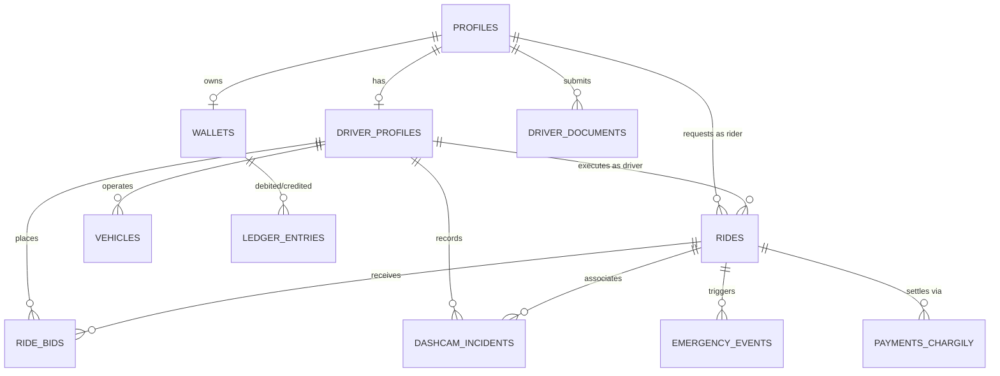

# Backend Schema and Database Architecture
## Next-Generation Smart Taxi and Mobility Platform for Algeria

---

## 1. Relational Entity Relationship Diagram



---

## 2. PostgreSQL DDL Schema and Core Extensions

```sql
-- Enable necessary PostgreSQL extensions
CREATE EXTENSION IF NOT EXISTS "uuid-ossp";
CREATE EXTENSION IF NOT EXISTS "postgis";
CREATE EXTENSION IF NOT EXISTS "pgcrypto";

-- ============================================================================
-- ENUM TYPES DEFINITION
-- ============================================================================

CREATE TYPE user_role AS ENUM (
    'rider',
    'driver',
    'fleet_manager',
    'dispatcher',
    'compliance_admin'
);

CREATE TYPE kyc_status_type AS ENUM (
    'unverified',
    'pending_review',
    'verified',
    'rejected',
    'suspended'
);

CREATE TYPE vehicle_category AS ENUM (
    'taxi_urbain',
    'taxi_collectif',
    'vtc_confort',
    'inter_wilaya'
);

CREATE TYPE ride_service_type AS ENUM (
    'taxi_individuel_metered',   -- Mode 1: Physical taximeter + regulated booking fee (CNRC 604103)
    'taxi_collectif_urbain',     -- Mode 2: Urban collective line, per-seat fare
    'taxi_collectif_inter_wilayas' -- Mode 3: Inter-wilaya station-to-station, per-seat fare
);

CREATE TYPE ride_status AS ENUM (
    'requested',
    'matching',
    'driver_assigned',
    'driver_arrived',
    'in_progress',
    'completed',
    'cancelled_by_rider',
    'cancelled_by_driver',
    'disputed'
);

CREATE TYPE payment_rail AS ENUM (
    'cash',
    'edahabia',
    'cib',
    'trustdesk_wallet'
);

CREATE TYPE payment_state AS ENUM (
    'pending',
    'authorized',
    'settled',
    'failed',
    'refunded'
);

CREATE TYPE dashcam_trigger AS ENUM (
    'g_sensor_impact',
    'hard_deceleration',
    'sos_rider',
    'sos_driver',
    'manual_driver_pin',
    'route_deviation'
);

CREATE TYPE incident_review_state AS ENUM (
    'pending_triage',
    'under_investigation',
    'cleared_no_fault',
    'driver_fault',
    'forwarded_to_police'
);

CREATE TYPE wallet_account_type AS ENUM (
    'rider_trustdesk',     -- Account 2010: Rider digital wallet
    'driver_operational',  -- Account 2020: Driver operating balance
    'system_cash_transit', -- Account 1010: Cash in transit (driver physical pocket)
    'system_escrow',       -- Account 1020: Digital escrow clearing
    'system_revenue'       -- Account 4010: Platform commission / booking fee
);

CREATE TYPE chargily_purpose AS ENUM (
    'ride_settlement',
    'driver_wallet_topup',
    'rider_wallet_topup'
);

-- ============================================================================
-- TABLE: PROFILES (Base User Registry mapped to Supabase Auth)
-- ============================================================================

CREATE TABLE public.profiles (
    id UUID PRIMARY KEY REFERENCES auth.users(id) ON DELETE CASCADE,
    phone_number VARCHAR(20) NOT NULL UNIQUE,
    full_name VARCHAR(120) NOT NULL,
    email VARCHAR(255),
    role user_role NOT NULL DEFAULT 'rider',
    preferred_language VARCHAR(10) NOT NULL DEFAULT 'fr', -- 'dz', 'ar', 'fr', 'en'
    avatar_url TEXT,
    kyc_status kyc_status_type NOT NULL DEFAULT 'unverified',
    is_active BOOLEAN NOT NULL DEFAULT true,
    created_at TIMESTAMPTZ NOT NULL DEFAULT timezone('utc'::text, now()),
    updated_at TIMESTAMPTZ NOT NULL DEFAULT timezone('utc'::text, now())
);

CREATE INDEX idx_profiles_phone ON public.profiles(phone_number);
CREATE INDEX idx_profiles_role ON public.profiles(role);

-- ============================================================================
-- TABLE: DRIVER_PROFILES (Regulatory Taxi Licensing and State)
-- ============================================================================

CREATE TABLE public.driver_profiles (
    user_id UUID PRIMARY KEY REFERENCES public.profiles(id) ON DELETE CASCADE,
    wilaya_code INT NOT NULL, -- e.g. 16 for Algiers, 31 for Oran
    municipal_license_number VARCHAR(50) NOT NULL UNIQUE, -- Numéro d'Agrément
    livret_de_place_number VARCHAR(50) NOT NULL UNIQUE,
    license_issue_date DATE NOT NULL,
    license_expiry_date DATE NOT NULL,
    criminal_record_checked BOOLEAN NOT NULL DEFAULT false,
    rating_avg NUMERIC(3, 2) NOT NULL DEFAULT 5.00,
    total_trips_completed INT NOT NULL DEFAULT 0,
    is_online BOOLEAN NOT NULL DEFAULT false,
    is_busy BOOLEAN NOT NULL DEFAULT false,
    current_h3_index VARCHAR(20),
    current_location GEOMETRY(Point, 4326),
    current_heading NUMERIC(5, 2) DEFAULT 0.0,
    current_speed_kmh NUMERIC(5, 2) DEFAULT 0.0,
    last_location_update TIMESTAMPTZ,
    dashcam_enabled BOOLEAN NOT NULL DEFAULT true,
    created_at TIMESTAMPTZ NOT NULL DEFAULT timezone('utc'::text, now()),
    updated_at TIMESTAMPTZ NOT NULL DEFAULT timezone('utc'::text, now())
);

CREATE INDEX idx_driver_location ON public.driver_profiles USING GIST(current_location);
CREATE INDEX idx_driver_h3 ON public.driver_profiles(current_h3_index);
CREATE INDEX idx_driver_online_busy ON public.driver_profiles(is_online, is_busy);

-- ============================================================================
-- TABLE: VEHICLES (Commercial Taxi Fleet Registry)
-- ============================================================================

CREATE TABLE public.vehicles (
    id UUID PRIMARY KEY DEFAULT uuid_generate_v4(),
    driver_id UUID NOT NULL REFERENCES public.driver_profiles(user_id) ON DELETE CASCADE,
    make VARCHAR(50) NOT NULL, -- e.g. Peugeot, Skoda, Hyundai
    model VARCHAR(50) NOT NULL, -- e.g. 301, Octavia, Accent
    year INT NOT NULL,
    license_plate VARCHAR(30) NOT NULL UNIQUE, -- Format Algérien: 10482-116-16
    color VARCHAR(30) NOT NULL,
    category vehicle_category NOT NULL DEFAULT 'taxi_urbain',
    total_passenger_seats INT NOT NULL DEFAULT 4,
    carte_grise_url TEXT NOT NULL,
    controle_technique_url TEXT NOT NULL,
    controle_technique_expiry DATE NOT NULL,
    assurance_commerciale_url TEXT NOT NULL,
    assurance_expiry DATE NOT NULL,
    is_verified BOOLEAN NOT NULL DEFAULT false,
    created_at TIMESTAMPTZ NOT NULL DEFAULT timezone('utc'::text, now()),
    updated_at TIMESTAMPTZ NOT NULL DEFAULT timezone('utc'::text, now())
);

CREATE INDEX idx_vehicles_driver ON public.vehicles(driver_id);
CREATE INDEX idx_vehicles_plate ON public.vehicles(license_plate);

-- ============================================================================
-- TABLE: DRIVER_DOCUMENTS (Audit Trail for Compliance Files)
-- ============================================================================

CREATE TABLE public.driver_documents (
    id UUID PRIMARY KEY DEFAULT uuid_generate_v4(),
    driver_id UUID NOT NULL REFERENCES public.driver_profiles(user_id) ON DELETE CASCADE,
    document_type VARCHAR(50) NOT NULL, -- 'cnib_front', 'cnib_back', 'livret_place', 'agrement', 'casier_judiciaire'
    file_url TEXT NOT NULL,
    sha256_hash VARCHAR(64) NOT NULL,
    verification_status kyc_status_type NOT NULL DEFAULT 'pending_review',
    rejection_reason TEXT,
    verified_by UUID REFERENCES public.profiles(id),
    verified_at TIMESTAMPTZ,
    created_at TIMESTAMPTZ NOT NULL DEFAULT timezone('utc'::text, now())
);

CREATE INDEX idx_documents_driver ON public.driver_documents(driver_id);

-- ============================================================================
-- TABLE: RIDES (Central Lifecycle and Telemetry Record)
-- ============================================================================

CREATE TABLE public.rides (
    id UUID PRIMARY KEY DEFAULT uuid_generate_v4(),
    ride_code VARCHAR(12) NOT NULL UNIQUE, -- e.g. DZ-84920
    rider_id UUID REFERENCES public.profiles(id), -- Nullable for collective rides (Modes 2 & 3)
    driver_id UUID REFERENCES public.driver_profiles(user_id),
    vehicle_id UUID REFERENCES public.vehicles(id),
    service_type ride_service_type NOT NULL DEFAULT 'taxi_individuel_metered',
    status ride_status NOT NULL DEFAULT 'requested',
    total_seats_allocated INT NOT NULL DEFAULT 4,
    available_seats INT NOT NULL DEFAULT 4,
    
    -- Geospatial pickup and drop-off
    origin_address TEXT NOT NULL,
    origin_commune VARCHAR(80),
    origin_wilaya_code INT NOT NULL,
    origin_location GEOMETRY(Point, 4326) NOT NULL,
    
    destination_address TEXT NOT NULL,
    destination_commune VARCHAR(80),
    destination_wilaya_code INT NOT NULL,
    destination_location GEOMETRY(Point, 4326) NOT NULL,
    
    route_polyline TEXT, -- Encoded route string
    distance_meters INT,
    duration_seconds INT,
    
    -- Pricing Structure under Décret 12-230 and CNRC 604103 (in DZD)
    meter_final_amount NUMERIC(10, 2), -- Calibrated physical taximeter reading
    frais_approche_amount NUMERIC(10, 2) NOT NULL DEFAULT 100.00, -- Regulated booking fee
    taximeter_photo_url TEXT, -- Optional OCR verification image of taximeter display
    fare_estimated NUMERIC(10, 2) NOT NULL,
    fare_final NUMERIC(10, 2),
    platform_commission_rate NUMERIC(4, 2) NOT NULL DEFAULT 10.00, -- 10%
    platform_commission_amount NUMERIC(10, 2),
    driver_payout_amount NUMERIC(10, 2),
    
    payment_method payment_rail NOT NULL DEFAULT 'cash',
    payment_state payment_state NOT NULL DEFAULT 'pending',
    pin_code VARCHAR(4) NOT NULL, -- 4-digit verification code to start trip
    
    -- Timestamps
    requested_at TIMESTAMPTZ NOT NULL DEFAULT timezone('utc'::text, now()),
    accepted_at TIMESTAMPTZ,
    arrived_at TIMESTAMPTZ,
    started_at TIMESTAMPTZ,
    completed_at TIMESTAMPTZ,
    cancelled_at TIMESTAMPTZ,
    cancellation_reason TEXT,
    
    created_at TIMESTAMPTZ NOT NULL DEFAULT timezone('utc'::text, now()),
    updated_at TIMESTAMPTZ NOT NULL DEFAULT timezone('utc'::text, now())
);

CREATE INDEX idx_rides_rider ON public.rides(rider_id);
CREATE INDEX idx_rides_driver ON public.rides(driver_id);
CREATE INDEX idx_rides_status ON public.rides(status);
CREATE INDEX idx_rides_origin_geom ON public.rides USING GIST(origin_location);
CREATE INDEX idx_rides_dest_geom ON public.rides USING GIST(destination_location);
CREATE INDEX idx_rides_created ON public.rides(created_at DESC);

-- ============================================================================
-- TABLE: RIDE_SEATS (Multi-Passenger Collective Seat Ledger for Modes 2 & 3)
-- ============================================================================

CREATE TABLE public.ride_seats (
    id UUID PRIMARY KEY DEFAULT uuid_generate_v4(),
    ride_id UUID NOT NULL REFERENCES public.rides(id) ON DELETE CASCADE,
    rider_id UUID NOT NULL REFERENCES public.profiles(id),
    seats_booked INT NOT NULL DEFAULT 1 CHECK (seats_booked > 0),
    fare_per_seat NUMERIC(10, 2) NOT NULL,
    pickup_address TEXT,
    dropoff_address TEXT,
    boarding_pin VARCHAR(4) NOT NULL,
    status VARCHAR(30) NOT NULL DEFAULT 'reserved', -- 'reserved', 'boarded', 'completed', 'cancelled'
    created_at TIMESTAMPTZ NOT NULL DEFAULT timezone('utc'::text, now())
);

CREATE INDEX idx_seats_ride ON public.ride_seats(ride_id);
CREATE INDEX idx_seats_rider ON public.ride_seats(rider_id);

-- ============================================================================
-- TABLE: RIDE_TRAJECTORIES (Batched PostGIS Trajectories decoupled from 1Hz live telemetry)
-- ============================================================================

CREATE TABLE public.ride_trajectories (
    id UUID PRIMARY KEY DEFAULT uuid_generate_v4(),
    ride_id UUID NOT NULL REFERENCES public.rides(id) ON DELETE CASCADE,
    driver_id UUID NOT NULL REFERENCES public.driver_profiles(user_id) ON DELETE CASCADE,
    trajectory GEOMETRY(LineStringM, 4326) NOT NULL, -- LineString with M dimension for timestamp
    point_count INT NOT NULL,
    start_timestamp TIMESTAMPTZ NOT NULL,
    end_timestamp TIMESTAMPTZ NOT NULL,
    flushed_at TIMESTAMPTZ NOT NULL DEFAULT timezone('utc'::text, now())
);

CREATE INDEX idx_trajectories_ride ON public.ride_trajectories(ride_id);
CREATE INDEX idx_trajectories_geom ON public.ride_trajectories USING GIST(trajectory);

-- ============================================================================
-- TABLE: RIDE_BIDS (Negotiated Inter-Wilaya Offers)
-- ============================================================================

CREATE TABLE public.ride_bids (
    id UUID PRIMARY KEY DEFAULT uuid_generate_v4(),
    ride_id UUID NOT NULL REFERENCES public.rides(id) ON DELETE CASCADE,
    driver_id UUID NOT NULL REFERENCES public.driver_profiles(user_id) ON DELETE CASCADE,
    offered_amount NUMERIC(10, 2) NOT NULL,
    driver_note TEXT,
    is_accepted BOOLEAN NOT NULL DEFAULT false,
    created_at TIMESTAMPTZ NOT NULL DEFAULT timezone('utc'::text, now())
);

CREATE INDEX idx_bids_ride ON public.ride_bids(ride_id);
CREATE INDEX idx_bids_driver ON public.ride_bids(driver_id);

-- ============================================================================
-- TABLE: DASHCAM_INCIDENTS (Incident Lockbox Evidence Registry)
-- ============================================================================

CREATE TABLE public.dashcam_incidents (
    id UUID PRIMARY KEY DEFAULT uuid_generate_v4(),
    ride_id UUID REFERENCES public.rides(id) ON DELETE SET NULL,
    driver_id UUID NOT NULL REFERENCES public.driver_profiles(user_id) ON DELETE CASCADE,
    trigger_type dashcam_trigger NOT NULL,
    peak_g_force NUMERIC(4, 2) NOT NULL,
    vehicle_speed_kmh NUMERIC(5, 2) NOT NULL,
    incident_location GEOMETRY(Point, 4326) NOT NULL,
    
    -- Storage and Encryption metadata
    storage_bucket VARCHAR(64) NOT NULL DEFAULT 'dashcam-evidence',
    storage_file_path TEXT NOT NULL,
    video_duration_seconds INT NOT NULL,
    file_size_bytes BIGINT NOT NULL,
    sha256_checksum VARCHAR(64) NOT NULL,
    aes_encryption_key_id VARCHAR(128) NOT NULL,
    
    review_status incident_review_state NOT NULL DEFAULT 'pending_triage',
    triage_notes TEXT,
    reviewed_by UUID REFERENCES public.profiles(id),
    reviewed_at TIMESTAMPTZ,
    created_at TIMESTAMPTZ NOT NULL DEFAULT timezone('utc'::text, now())
);

CREATE INDEX idx_dashcam_ride ON public.dashcam_incidents(ride_id);
CREATE INDEX idx_dashcam_driver ON public.dashcam_incidents(driver_id);
CREATE INDEX idx_dashcam_geom ON public.dashcam_incidents USING GIST(incident_location);
CREATE INDEX idx_dashcam_status ON public.dashcam_incidents(review_status);

-- ============================================================================
-- TABLE: WALLETS (Financial Accounts for Platform, Drivers, and Riders)
-- ============================================================================

-- ============================================================================
-- TABLE: WALLETS (Financial Accounts for Platform, Drivers, Riders, and System GL)
-- ============================================================================

CREATE TABLE public.wallets (
    id UUID PRIMARY KEY DEFAULT uuid_generate_v4(),
    user_id UUID UNIQUE REFERENCES public.profiles(id) ON DELETE CASCADE, -- Nullable for system GL accounts
    account_type wallet_account_type NOT NULL DEFAULT 'rider_trustdesk',
    system_account_code VARCHAR(16) UNIQUE, -- e.g. '1010', '1020', '4010'
    balance_dzd NUMERIC(12, 2) NOT NULL DEFAULT 0.00,
    min_allowed_balance_dzd NUMERIC(12, 2) NOT NULL DEFAULT 0.00, -- Hard balance floor
    currency VARCHAR(3) NOT NULL DEFAULT 'DZD',
    is_frozen BOOLEAN NOT NULL DEFAULT false,
    created_at TIMESTAMPTZ NOT NULL DEFAULT timezone('utc'::text, now()),
    updated_at TIMESTAMPTZ NOT NULL DEFAULT timezone('utc'::text, now()),
    
    CONSTRAINT chk_wallet_balance_floor CHECK (balance_dzd >= min_allowed_balance_dzd),
    CONSTRAINT chk_wallet_owner_or_system CHECK (
        (user_id IS NOT NULL AND system_account_code IS NULL) OR 
        (user_id IS NULL AND system_account_code IS NOT NULL)
    )
);

CREATE INDEX idx_wallets_user ON public.wallets(user_id);
CREATE INDEX idx_wallets_system ON public.wallets(system_account_code);

-- ============================================================================
-- TABLE: LEDGER_ENTRIES (Immutable Double-Entry Ledger with Idempotency)
-- ============================================================================

CREATE TABLE public.ledger_entries (
    id UUID PRIMARY KEY DEFAULT uuid_generate_v4(),
    idempotency_key VARCHAR(128) NOT NULL UNIQUE, -- Prevents SMS + 3G retry double-settlement
    batch_id UUID NOT NULL DEFAULT uuid_generate_v4(),
    debit_wallet_id UUID NOT NULL REFERENCES public.wallets(id),
    credit_wallet_id UUID NOT NULL REFERENCES public.wallets(id),
    amount_dzd NUMERIC(12, 2) NOT NULL CHECK (amount_dzd > 0),
    entry_type VARCHAR(50) NOT NULL, -- 'commission_debit', 'fare_settlement', 'spare_change_credit', 'wallet_topup'
    ride_id UUID REFERENCES public.rides(id),
    description TEXT NOT NULL,
    created_at TIMESTAMPTZ NOT NULL DEFAULT timezone('utc'::text, now()),
    
    CONSTRAINT chk_distinct_wallets CHECK (debit_wallet_id <> credit_wallet_id)
);

CREATE INDEX idx_ledger_debit ON public.ledger_entries(debit_wallet_id);
CREATE INDEX idx_ledger_credit ON public.ledger_entries(credit_wallet_id);
CREATE INDEX idx_ledger_ride ON public.ledger_entries(ride_id);
CREATE INDEX idx_ledger_batch ON public.ledger_entries(batch_id);
CREATE INDEX idx_ledger_idempotency ON public.ledger_entries(idempotency_key);

-- ============================================================================
-- TABLE: PAYMENTS_CHARGILY (CIB & Edahabia Integration Gateway)
-- ============================================================================

CREATE TABLE public.payments_chargily (
    id UUID PRIMARY KEY DEFAULT uuid_generate_v4(),
    ride_id UUID REFERENCES public.rides(id), -- Nullable for driver/rider wallet top-ups
    user_id UUID NOT NULL REFERENCES public.profiles(id),
    wallet_id UUID REFERENCES public.wallets(id), -- Target wallet for direct card top-up
    purpose chargily_purpose NOT NULL DEFAULT 'ride_settlement',
    checkout_id VARCHAR(120) NOT NULL UNIQUE,
    amount_dzd NUMERIC(10, 2) NOT NULL,
    status VARCHAR(30) NOT NULL DEFAULT 'created', -- 'created', 'paid', 'failed', 'canceled'
    payment_mode VARCHAR(20), -- 'EDAHABIA', 'CIB'
    chargily_fees_dzd NUMERIC(10, 2) DEFAULT 0.00,
    raw_webhook_payload JSONB,
    created_at TIMESTAMPTZ NOT NULL DEFAULT timezone('utc'::text, now()),
    updated_at TIMESTAMPTZ NOT NULL DEFAULT timezone('utc'::text, now())
);

CREATE INDEX idx_chargily_checkout ON public.payments_chargily(checkout_id);
CREATE INDEX idx_chargily_ride ON public.payments_chargily(ride_id);
CREATE INDEX idx_chargily_wallet ON public.payments_chargily(wallet_id);

-- ============================================================================
-- TABLE: EMERGENCY_EVENTS (High-Priority SOS Dispatches)
-- ============================================================================

CREATE TABLE public.emergency_events (
    id UUID PRIMARY KEY DEFAULT uuid_generate_v4(),
    ride_id UUID NOT NULL REFERENCES public.rides(id),
    triggered_by UUID NOT NULL REFERENCES public.profiles(id),
    trigger_role user_role NOT NULL,
    location GEOMETRY(Point, 4326) NOT NULL,
    speed_kmh NUMERIC(5, 2) NOT NULL,
    status VARCHAR(30) NOT NULL DEFAULT 'active', -- 'active', 'contacted', 'police_dispatched', 'resolved'
    operator_notes TEXT,
    resolved_at TIMESTAMPTZ,
    created_at TIMESTAMPTZ NOT NULL DEFAULT timezone('utc'::text, now())
);

CREATE INDEX idx_emergency_ride ON public.emergency_events(ride_id);
CREATE INDEX idx_emergency_status ON public.emergency_events(status);

-- ============================================================================
-- ROW LEVEL SECURITY (RLS) POLICIES
-- ============================================================================

-- Enable RLS across all tables
ALTER TABLE public.profiles ENABLE ROW LEVEL SECURITY;
ALTER TABLE public.driver_profiles ENABLE ROW LEVEL SECURITY;
ALTER TABLE public.vehicles ENABLE ROW LEVEL SECURITY;
ALTER TABLE public.rides ENABLE ROW LEVEL SECURITY;
ALTER TABLE public.ride_seats ENABLE ROW LEVEL SECURITY;
ALTER TABLE public.ride_trajectories ENABLE ROW LEVEL SECURITY;
ALTER TABLE public.dashcam_incidents ENABLE ROW LEVEL SECURITY;
ALTER TABLE public.wallets ENABLE ROW LEVEL SECURITY;
ALTER TABLE public.ledger_entries ENABLE ROW LEVEL SECURITY;
ALTER TABLE public.payments_chargily ENABLE ROW LEVEL SECURITY;
ALTER TABLE public.emergency_events ENABLE ROW LEVEL SECURITY;

-- 1. PROFILES POLICIES
CREATE POLICY "Users can read their own profile"
    ON public.profiles FOR SELECT
    USING (auth.uid() = id);

CREATE POLICY "Users can update their own profile"
    ON public.profiles FOR UPDATE
    USING (auth.uid() = id);

-- 2. DRIVER_PROFILES POLICIES (Scraping Protection)
-- Restrict reading so riders cannot harvest all online drivers' municipal license numbers
CREATE POLICY "Drivers read own profile or assigned rider reads driver"
    ON public.driver_profiles FOR SELECT
    USING (
        auth.uid() = user_id OR
        EXISTS (
            SELECT 1 FROM public.rides r
            WHERE r.driver_id = public.driver_profiles.user_id
            AND r.status IN ('driver_assigned', 'driver_arrived', 'in_progress')
            AND (
                r.rider_id = auth.uid() OR
                EXISTS (
                    SELECT 1 FROM public.ride_seats rs
                    WHERE rs.ride_id = r.id AND rs.rider_id = auth.uid()
                )
            )
        )
    );

CREATE POLICY "Drivers can update their own operational state"
    ON public.driver_profiles FOR UPDATE
    USING (auth.uid() = user_id);

-- 3. RIDES POLICIES (Support Collective Seat Passengers)
CREATE POLICY "Participants read assigned rides"
    ON public.rides FOR SELECT
    USING (
        auth.uid() = rider_id OR 
        auth.uid() = driver_id OR 
        EXISTS (
            SELECT 1 FROM public.ride_seats rs 
            WHERE rs.ride_id = public.rides.id AND rs.rider_id = auth.uid()
        )
    );

CREATE POLICY "Riders can insert new ride requests"
    ON public.rides FOR INSERT
    WITH CHECK (auth.uid() = rider_id);

CREATE POLICY "Involved parties can update ride state"
    ON public.rides FOR UPDATE
    USING (auth.uid() = rider_id OR auth.uid() = driver_id);

-- 4. RIDE_SEATS POLICIES
CREATE POLICY "Riders read own seat bookings"
    ON public.ride_seats FOR SELECT
    USING (auth.uid() = rider_id);

CREATE POLICY "Drivers read seats for assigned rides"
    ON public.ride_seats FOR SELECT
    USING (
        EXISTS (
            SELECT 1 FROM public.rides r
            WHERE r.id = public.ride_seats.ride_id AND r.driver_id = auth.uid()
        )
    );

-- 5. DASHCAM INCIDENTS POLICIES
-- Zero public access. Only drivers involved can view metadata; raw footage access restricted to admins
CREATE POLICY "Drivers can view incident metadata they generated"
    ON public.dashcam_incidents FOR SELECT
    USING (auth.uid() = driver_id);

-- 6. WALLET POLICIES
CREATE POLICY "Users can view only their own wallet"
    ON public.wallets FOR SELECT
    USING (auth.uid() = user_id);

-- 7. ATOMIC SPARE CHANGE CREDIT STORED PROCEDURE (Anti-Fraud & Race-Condition Hardened)
CREATE OR REPLACE FUNCTION public.execute_spare_change_credit(
    p_ride_id UUID,
    p_driver_id UUID,
    p_rider_id UUID,
    p_change_amount NUMERIC(10, 2),
    p_idempotency_key VARCHAR(128)
)
RETURNS JSONB
LANGUAGE plpgsql
SECURITY DEFINER
AS $$
DECLARE
    v_driver_wallet_id UUID;
    v_rider_wallet_id UUID;
    v_driver_balance NUMERIC(12, 2);
    v_driver_floor NUMERIC(12, 2);
    v_batch_id UUID := uuid_generate_v4();
    v_ride_status ride_status;
    v_ride_driver UUID;
    v_ride_rider UUID;
BEGIN
    -- 1. Security & Caller Authorization: Must be authenticated driver or service role
    IF auth.uid() IS NOT NULL AND auth.uid() <> p_driver_id THEN
        RAISE EXCEPTION 'Unauthorized: Caller auth.uid (%) does not match driver ID (%)', auth.uid(), p_driver_id;
    END IF;

    -- 2. Cap spare change at 200.00 DZD per transaction to prevent money-laundering loops
    IF p_change_amount <= 0.00 OR p_change_amount > 200.00 THEN
        RAISE EXCEPTION 'Change amount must be between 1.00 and 200.00 DZD';
    END IF;

    -- 3. Ride Ownership & State Validation
    SELECT status, driver_id, rider_id
    INTO v_ride_status, v_ride_driver, v_ride_rider
    FROM public.rides
    WHERE id = p_ride_id;

    IF NOT FOUND THEN
        RAISE EXCEPTION 'Ride % not found', p_ride_id;
    END IF;

    IF v_ride_driver <> p_driver_id THEN
        RAISE EXCEPTION 'Ride % is not assigned to driver %', p_ride_id, p_driver_id;
    END IF;

    IF v_ride_rider IS NOT NULL AND v_ride_rider <> p_rider_id THEN
        RAISE EXCEPTION 'Ride % rider mismatch: expected %, received %', p_ride_id, v_ride_rider, p_rider_id;
    END IF;

    IF v_ride_status NOT IN ('in_progress', 'completed') THEN
        RAISE EXCEPTION 'Ride % must be in_progress or completed to settle change (current: %)', p_ride_id, v_ride_status;
    END IF;

    -- 4. Idempotency Guard: Prevent double-spend
    IF EXISTS (SELECT 1 FROM public.ledger_entries WHERE idempotency_key = p_idempotency_key) THEN
        RETURN jsonb_build_object(
            'success', true,
            'status', 'already_processed',
            'amount_credited', p_change_amount,
            'idempotency_key', p_idempotency_key
        );
    END IF;

    -- 5. Fetch and Lock Driver Operational Wallet (FOR UPDATE row lock prevents race conditions)
    SELECT id, balance_dzd, min_allowed_balance_dzd
    INTO v_driver_wallet_id, v_driver_balance, v_driver_floor
    FROM public.wallets
    WHERE user_id = p_driver_id AND account_type = 'driver_operational'
    FOR UPDATE;

    IF v_driver_wallet_id IS NULL THEN
        RAISE EXCEPTION 'Driver operational wallet not found for user %', p_driver_id;
    END IF;

    -- 6. Enforce hard balance floor: Driver must have enough digital balance to fund change
    IF (v_driver_balance - p_change_amount) < v_driver_floor THEN
        RAISE EXCEPTION 'Driver operational balance insufficient to credit change (Balance: %, Required: %)', 
            v_driver_balance, (v_driver_floor + p_change_amount);
    END IF;

    -- 7. Fetch and Lock Rider TrustDesk Wallet (FOR UPDATE row lock)
    SELECT id INTO v_rider_wallet_id
    FROM public.wallets
    WHERE user_id = p_rider_id AND account_type = 'rider_trustdesk'
    FOR UPDATE;

    IF v_rider_wallet_id IS NULL THEN
        RAISE EXCEPTION 'Rider TrustDesk wallet not found for user %', p_rider_id;
    END IF;

    -- 8. Deduct from Driver Operational Wallet
    UPDATE public.wallets
    SET balance_dzd = balance_dzd - p_change_amount, updated_at = now()
    WHERE id = v_driver_wallet_id;

    -- 9. Credit to Rider TrustDesk Wallet
    UPDATE public.wallets
    SET balance_dzd = balance_dzd + p_change_amount, updated_at = now()
    WHERE id = v_rider_wallet_id;

    -- 10. Record immutable double-entry ledger record
    INSERT INTO public.ledger_entries (
        idempotency_key, batch_id, debit_wallet_id, credit_wallet_id,
        amount_dzd, entry_type, ride_id, description
    ) VALUES (
        p_idempotency_key, v_batch_id, v_driver_wallet_id, v_rider_wallet_id,
        p_change_amount, 'spare_change_credit', p_ride_id,
        'Spare cash change credited to rider TrustDesk wallet'
    );

    RETURN jsonb_build_object(
        'success', true,
        'status', 'executed',
        'amount_credited', p_change_amount,
        'batch_id', v_batch_id
    );
END;
$$;

CREATE POLICY "System and drivers can insert incident records"
    ON public.dashcam_incidents FOR INSERT
    WITH CHECK (auth.uid() = driver_id);

-- 5. WALLET POLICIES
CREATE POLICY "Users can view only their own wallet"
    ON public.wallets FOR SELECT
    USING (auth.uid() = user_id);
```

---

## 4. Geospatial Proximity Matching RPC Function

This stored procedure executes high-performance radius searches for candidate drivers using PostGIS spatial indexing before invoking the routing engine.

```sql
CREATE OR REPLACE FUNCTION public.find_nearest_licensed_taxis(
    p_pickup_geom GEOMETRY,
    p_radius_meters INT DEFAULT 3000,
    p_limit INT DEFAULT 10
)
RETURNS TABLE (
    driver_id UUID,
    full_name VARCHAR,
    phone_number VARCHAR,
    rating NUMERIC,
    vehicle_model VARCHAR,
    license_plate VARCHAR,
    distance_meters DOUBLE PRECISION,
    current_location GEOMETRY
)
LANGUAGE plpgsql
SECURITY DEFINER
AS $$
BEGIN
    RETURN QUERY
    SELECT 
        d.user_id AS driver_id,
        p.full_name,
        p.phone_number,
        d.rating_avg AS rating,
        CONCAT(v.make, ' ', v.model)::VARCHAR AS vehicle_model,
        v.license_plate,
        ST_Distance(d.current_location::geography, p_pickup_geom::geography) AS distance_meters,
        d.current_location
    FROM public.driver_profiles d
    JOIN public.profiles p ON d.user_id = p.id
    JOIN public.vehicles v ON d.user_id = v.driver_id
    WHERE 
        d.is_online = true 
        AND d.is_busy = false
        AND p.kyc_status = 'verified'
        AND ST_DWithin(d.current_location::geography, p_pickup_geom::geography, p_radius_meters)
    ORDER BY distance_meters ASC
    LIMIT p_limit;
END;
$$;
```
