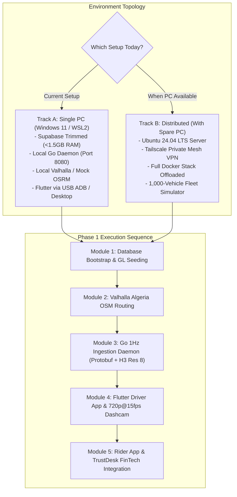

# Algeria Smart Taxi & Mobility Platform
# Phase 1 Execution & Master Tooling Playbook

---

## 1. Executive Strategy & Dual-Track Execution Architecture

This playbook defines the exact sequence of engineering actions, tools, MCP servers, and module boundaries required to build and deploy Phase 1 of the platform.

To maximize agility, the architecture supports two operating environments without requiring code changes:
- **Track A (Primary / Starting Point: Single-Machine Local Workstation)**: Everything runs locally on your primary Windows 11 machine via Docker Desktop (WSL2), trimmed for minimal memory overhead (<1.5 GB idle RAM).
- **Track B (Optional / Scale-Out: Distributed Dual-Machine Setup)**: Offloads backend containers, OpenStreetMap routing compilation, and telemetry load-generation to a dedicated Ubuntu 24.04 LTS spare PC connected via Tailscale.



---

## 2. Environment Comparison: Single PC vs. Dual PC

| Component | Track A: Single PC (Current Setup) | Track B: Dual PC (With Spare PC) |
| :--- | :--- | :--- |
| **Operating System** | Windows 11 Pro + WSL2 (Ubuntu 24.04) | Windows 11 (Client) + Ubuntu 24.04 LTS (Server) |
| **Database & MinIO** | Docker Desktop WSL2 (`localhost:54322`) | Headless Docker Compose on Spare PC (`100.x.y.z:54322`) |
| **RAM Budgeting** | Disable `supabase-analytics` (Logflare) and `vector`<br/>**Idle RAM: ~1.4 GB to 1.6 GB** | Full Docker stack including monitoring & telemetry logs<br/>**Idle RAM: 3.5 GB to 5.0 GB** |
| **Routing Engine** | Local Valhalla container or pre-extracted Algiers region | Full Algeria OSM compile (`algeria-latest.osm.pbf`, ~130MB) |
| **Go 1Hz Daemon** | Native Go 1.22 binary running on `localhost:8080` | Containerized Go daemon running on Spare PC |
| **Mobile Testing** | Android phone via USB ADB / Flutter Windows Desktop | Android phone over Wi-Fi ADB + Tailscale network link |
| **Load Testing** | 50 virtual drivers (unit benchmark) | 1,000 to 2,000 virtual drivers (stress testing) |

---

## 3. Comprehensive Tooling, Ecosystem & MCP Inventory

### 3.1 Core Runtimes and Compilers
- **Go 1.22+**: Core ingestion engine, WebSockets hub, binary Protobuf unpacker, in-memory Uber H3 spatial index, and PostGIS batch writer.
- **Flutter 3.24+ / Dart 3.5+**: Cross-platform mobile clients (Rider App and Driver App) targeting Android API 26+ and iOS 15+.
- **PostgreSQL 16 + PostGIS 3.4 + pg_h3**: Self-hosted relational core with geospatial indexing and double-entry ledger constraints.
- **Docker & Docker Compose v2**: Container orchestration for Supabase, MinIO, Valhalla, Redis/Valkey, and HashiCorp Vault.
- **Protoc (Protocol Buffers v3)**: Compiles the 32-byte binary telemetry schema into Go structs and Dart classes.
- **Tailscale**: Zero-config WireGuard mesh network connecting the development laptop, mobile devices, and the spare PC.

### 3.2 Repositories, FinTech SDKs & Code Assets
- **Chargily Pay Dart SDK (`chargily-pay-dart`)**: Official client package for instant CIB and Edahabia top-ups with SATIM 3DS OTP support.
- **TrustDesk Codebase (`d:\TrustDesk`)**:
  - `trustvault-mobile/lib/providers/wallet_provider.dart`: Riverpod 2 stored-value balance state machine.
  - `trustvault-mobile/lib/widgets/kyc_gate.dart`: Biometric facial and fingerprint authentication wrapper.
  - Localized Algerian Arabic and French currency formatting widgets.
- **Geofabrik Algeria OpenStreetMap**: `algeria-latest.osm.pbf` (~130 MB) providing road geometry, one-way markers, and highway tags.

### 3.3 Active MCP Servers & Specific Routing
- **`graphify`**: AST knowledge graph, dependency traversal, and impact analysis (`query_graph`, `god_nodes`, `shortest_path`). Run `graphify update .` to index new Go, SQL, and Flutter files into the AST graph to track relationships and prevent broken imports.
- **`headroom`**: Semantic context compression (`headroom_compress`, `headroom_retrieve`, `headroom_stats`). Proactively compresses compiler dumps, large SQL migration diffs, and telemetry logs to preserve token budget.
- **`supabase-mcp-trustvault`**: Database isolation, schema inspection, SQL execution, RLS policy audit, and migration validation.
- **`dart-mcp-server` & `flutter_dart-mcp-server`**: AST inspection, `analyze_files`, runtime diagnostics, and widget tree inspection.
- **`filesystem`**: Surgical file read/write operations and workspace synchronization.
- **`github-mcp-server`**: Repository version control, branch management, and PR staging.
- **`word-mcp-live`, `safe-docx`, `docx-editor`**: Document verification, regulatory filings, and municipal transport contract generation.
- **`scrapling-mcp` & `agent-reach`**: Anti-bot scraping, documentation extraction, and multi-platform access.
- **`21st-dev` & `StitchMCP`**: Sourcing high-contrast cockpit components and navigation HUD layouts.

### 3.4 Ecosystem Repositories (`D:\TrustDesk\ecosystem_tools\`)
- **`ponytail` (`ecosystem_tools/ponytail/`)**: Enforces standard library first, eliminates bloat (`ponytail-audit`), and runs diff reviews (`ponytail-review`).
- **`OpenViking` (`ecosystem_tools/OpenViking/`)**: Tiered L0/L1/L2 hierarchical context database to avoid token exhaustion.
- **`pipecat` (`ecosystem_tools/pipecat/`)**: Sub-500ms voice conversational pipeline for hands-free driver audio dispatch and safety emergency triage.
- **`playwright-cli` (`ecosystem_tools/playwright-cli/`)**: Automated headless browser testing and visual screenshot validation for the dispatch portal.
- **`twenty` (`ecosystem_tools/twenty/`)**: Open-source CRM for driver onboarding verification and municipal taxi cooperative management.
- **`nocodb` (`ecosystem_tools/nocodb/`)**: Smart spreadsheet and relational database interface over PostgreSQL for fleet operations.
- **`liquid-glass-js` & `thinking-orbs`**: Modern WebGL 2.0 glassmorphism and reasoning state visual indicators for web dispatch monitors.

### 3.5 Skill Governance & Behavioral Gates
- `humanizer`: **Mandatory zero-exception rule**. Natural, direct engineering prose without AI clichés, no em/en dashes, and no superficial participles.
- `fintech-state-integrity-auditor`: Validates double-entry balance floors, idempotency keys, and prevents floating-point monetary drift.
- `flutter-expert` & `dart-flutter-patterns`: Flutter 3 architecture, Slivers, Riverpod 2, CameraX lifecycle, and null safety.
- `systematic-debugging`: Enforces four-phase root cause isolation before applying code edits.
- `security-review`: RLS auditing, envelope encryption key derivation, and Shamir Secret Sharing compliance.

---

## 4. Phase 1 Module-by-Module Scoped Roadmap

```
+---------------------------------------------------------------------------------------+
| MODULE 1: Database Bootstrap & System GL Seeding (Day 1 - 2)                          |
| - Stand up trimmed self-hosted Supabase Docker Compose (<1.5 GB RAM)                  |
| - Execute 05_BACKEND_SCHEMA DDL with hardened execute_spare_change_credit             |
| - Seed system GL accounts: 1010 (Cash), 1020 (Escrow), 4010 (Platform Revenue)       |
+---------------------------------------------------------------------------------------+
                                           |
                                           v
+---------------------------------------------------------------------------------------+
| MODULE 2: Algeria Valhalla Routing Engine (Day 3 - 4)                                 |
| - Download algeria-latest.osm.pbf (~130 MB) from Geofabrik                            |
| - Run one-off Valhalla tile build job (output: /custom_files/valhalla_tiles)          |
| - Mount tile directory read-only into routing container and test Algiers-Blida route  |
+---------------------------------------------------------------------------------------+
                                           |
                                           v
+---------------------------------------------------------------------------------------+
| MODULE 3: Go 1Hz Telemetry Ingestion Daemon (Day 5 - 8)                               |
| - Define 32-byte Protobuf location ping (lat, lon, heading, speed, status, timestamp) |
| - Implement Go WebSockets hub with client sequence counters and ping/pong heartbeat   |
| - Build in-memory H3 Res 8 spatial index (kRing 1-2 candidate matching in <5ms)       |
| - Implement 60-second batched LineStringM trajectory flusher to PostGIS               |
+---------------------------------------------------------------------------------------+
                                           |
                                           v
+---------------------------------------------------------------------------------------+
| MODULE 4: Flutter Driver App & Dashcam Subsystem (Day 9 - 13)                         |
| - Scaffold Flutter 3 monorepo with Riverpod 2 state management                        |
| - Implement CameraX 720p@15fps hardware MediaCodec rolling circular buffer (3x 60s)   |
| - Attach PowerManager.OnThermalStatusChangedListener for cockpit thermal load-shedding|
| - Integrate MapLibre GL Native with dark cockpit navigation skin                      |
+---------------------------------------------------------------------------------------+
                                           |
                                           v
+---------------------------------------------------------------------------------------+
| MODULE 5: Rider App & TrustDesk FinTech Integration (Day 14 - 18)                     |
| - Port TrustDesk Riverpod wallet provider, KycGate, and Algerian currency widgets    |
| - Integrate chargily-pay-dart SDK for CIB/Edahabia zero-touch wallet top-ups          |
| - Build Mode 1 / 2 / 3 booking flow with PIN verification                             |
| - Execute end-to-end trip completion and test the 200 DZD spare change flywheel       |
+---------------------------------------------------------------------------------------+
```

---

## 5. Detailed Module Specifications

### Module 1: Database Bootstrap & System GL Seeding

#### 1.1 Docker Compose Configuration (Low-Memory Trim)
To keep idle RAM under 1.5 GB on a single Windows development machine, we prune non-essential analytics and vector engines:
- Keep: `supabase-db` (PostgreSQL 16 + PostGIS), `supabase-auth` (GoTrue), `supabase-rest` (PostgREST), `supabase-realtime`, `supabase-storage` (MinIO backed), `supabase-kong` (API Gateway), and `supabase-studio`.
- Disable: `supabase-analytics` (Logflare / Vector ingestion) and `supabase-vector` (pgvector background indexer).

#### 1.2 Database Migration Script
Apply the complete DDL from [05_BACKEND_SCHEMA_AND_DATABASE_ARCHITECTURE.md](file:///d:/dash/docs/05_BACKEND_SCHEMA_AND_DATABASE_ARCHITECTURE.md), containing:
- 10 core tables (`profiles`, `driver_profiles`, `vehicles`, `driver_documents`, `rides`, `ride_seats`, `ride_trajectories`, `dashcam_incidents`, `wallets`, `ledger_entries`, `payments_chargily`).
- Hardened RLS policies preventing municipal license harvesting.
- The hardened PL/pgSQL function `execute_spare_change_credit()` with `auth.uid()` validation, ride ownership verification, idempotency guard, and `FOR UPDATE` row locks.

#### 1.3 System General Ledger (GL) Seed Data
Seed the three core platform double-entry accounts into `public.wallets`:
```sql
INSERT INTO public.wallets (id, user_id, account_type, system_account_code, balance_dzd, min_allowed_balance_dzd, currency)
VALUES
    ('00000000-0000-0000-0000-000000001010', NULL, 'system_cash_transit', '1010', 0.00, -100000000.00, 'DZD'),
    ('00000000-0000-0000-0000-000000001020', NULL, 'system_escrow', '1020', 0.00, 0.00, 'DZD'),
    ('00000000-0000-0000-0000-000000004010', NULL, 'system_revenue', '4010', 0.00, 0.00, 'DZD')
ON CONFLICT (system_account_code) DO NOTHING;
```

---

### Module 2: Valhalla Algeria Routing Engine

#### 2.1 Data Extraction & Ingestion
1. Download the latest Algeria OpenStreetMap extract from Geofabrik:
   ```bash
   curl -O https://download.geofabrik.de/africa/algeria-latest.osm.pbf
   ```
2. Run the one-off tile builder using the official Valhalla Docker image:
   ```bash
   docker run --rm -v ${PWD}/valhalla_tiles:/custom_files \
     ghcr.io/valhalla/valhalla:latest \
     valhalla_build_tiles -c /custom_files/valhalla.json /custom_files/algeria-latest.osm.pbf
   ```
3. Launch the lightweight Valhalla server mounting `/custom_files/valhalla_tiles` read-only.
4. Verify routing response between Algiers 1st of May Square (36.7538, 3.0588) and Kouba (36.7262, 3.0872), ensuring distance matrix calculation returns within 15ms.

---

### Module 3: Go 1Hz Telemetry Ingestion Daemon

#### 3.1 Binary Protobuf Protocol Schema
Create `proto/telemetry.proto` specifying the compact 32-byte location frame:
```protobuf
syntax = "proto3";
package telemetry;

message LocationPing {
  string driver_id = 1;
  double latitude = 2;
  double longitude = 3;
  float heading = 4;
  float speed_kmh = 5;
  int64 timestamp_utc = 6;
  uint32 sequence_number = 7;
  bool is_busy = 8;
  string current_ride_id = 9;
}
```

#### 3.2 In-Memory H3 Indexing Engine
- The Go daemon maintains an in-memory concurrent map: `map[h3.Cell]map[string]*DriverState`.
- Every incoming 1Hz coordinate is indexed to H3 Resolution 8 (`h3.LatLngToCell(lat, lng, 8)`).
- When a ride request arrives, the matching service calls `h3.GridDisk(cell, 2)` (covering ~2.5 km radius) and retrieves active candidate drivers in $O(1)$ time without querying PostgreSQL.
- Top 15 candidates are sent to the local Valhalla instance to compute actual street driving ETAs, returning the top 3 drivers.

#### 3.3 Trajectory Batch Flusher
- Instead of writing 1Hz points to PostGIS, coordinates are appended to an in-memory buffer per active ride.
- Every 60 seconds (or upon ride status changing to `completed`), the buffer is compressed into a PostGIS `LineStringM` geometry (where M stores epoch seconds) and written in a single batched `INSERT` into `public.ride_trajectories`.

---

### Module 4: Flutter Driver App & 720p@15fps Dashcam

#### 4.1 Cockpit UI & Touch Targets
- High-contrast visual theme: `#0A1128` deep navy background, `#F5A623` taxi gold accent, `#FFFFFF` text.
- 64dp minimum touch target height across all actionable cockpit buttons.
- Full RTL and LTR bidirectional layout mirroring supporting Algerian Darija, Arabic, French, and English.

#### 4.2 Dashcam Circular Buffer Architecture
- Android CameraX implementation using `SurfaceView` and `MediaCodec` hardware encoder.
- Encoding locked to 720p (1280x720) at 15 fps and 2.0 Mbps bitrate, generating ~15 MB per 60-second chunk.
- Maintains a rolling 3-file buffer on local app storage (maximum disk usage: 45 MB).
- When an incident trigger occurs (G-sensor impact $\ge 2.5G$, SOS tap, or speed drop $>35 \text{ km/h}$ in 1s), the current and previous chunks are frozen, encrypted with AES-256-GCM, and queued for upload to MinIO.

#### 4.3 Thermal Load-Shedding State Machine
Implement `PowerManager.OnThermalStatusChangedListener` in Android platform channel:
- `THERMAL_STATUS_NONE` / `LIGHT`: Full operation (Camera 720p@15fps, MapLibre 60fps).
- `THERMAL_STATUS_MODERATE`: Throttle MapLibre rendering to 25fps, dim screen brightness by 20%.
- `THERMAL_STATUS_SEVERE`: Pause CameraX video recording (maintain GPS telemetry and dispatch audio alerts), alert driver.
- `THERMAL_STATUS_CRITICAL`: Suspend map rendering, run audio-only dispatch to prevent phone thermal shutdown.

---

### Module 5: Rider App & TrustDesk FinTech Integration

#### 5.1 TrustDesk Codebase Reuse
- Ingest `d:\TrustDesk\trustvault-mobile\lib\providers\wallet_provider.dart` into `packages/fintech_wallet`.
- Use the existing biometric `KycGate` for card top-ups and cash change withdrawals.
- Re-use the existing Algerian Arabic and French currency formatter widgets for consistent dinar formatting (`1 250,00 دج` / `1.250,00 DZD`).

#### 5.2 Chargily Pay Dart Integration
- Add `chargily_pay: ^2.0.0` to the driver and rider apps.
- Implement in-app card checkout allowing drivers to top up their operational balance in 500 DZD, 1,000 DZD, or 3,000 DZD denominations via SATIM/Algérie Poste 3DS OTP.

#### 5.3 The Spare Change Flywheel Execution
- At trip completion for cash payments, driver enters tendered amount (e.g. 1,000 DZD for an 850 DZD fare).
- The Driver App calls `execute_spare_change_credit(ride_id, driver_id, rider_id, 150.00, idempotency_key)`.
- The procedure verifies the driver digital balance floor, deducts 150 DZD from the driver operational wallet, credits 150 DZD to the rider TrustDesk wallet, and records double-entry ledger entries in a single atomic transaction.

---

## 6. Verification and Readiness Checklist

Before moving from planning to implementation, verify the following prerequisites:

- [x] All 4 SQL schema and anti-fraud patches applied to `docs/05_BACKEND_SCHEMA_AND_DATABASE_ARCHITECTURE.md`.
- [x] Hardened `execute_spare_change_credit` PL/pgSQL function with `auth.uid()`, ride validation, idempotency guard, and `FOR UPDATE` row locks integrated into `ALGERIA_SMART_TAXI_MASTER_SPECIFICATION_FOR_ARAGON.md`.
- [x] Section 11 consensus updated with Res 8 H3 spatial pool, WebSockets Protobuf protocol, Shamir 2-of-3 envelope encryption, and INT8 TFLite taximeter OCR.
- [x] Dual-track execution strategy formalized for both Single PC (WSL2) and Dual PC (Ubuntu Spare Server).
- [x] Memory footprint budgeted under 1.5 GB idle RAM by pruning Logflare and vector containers.
- [x] Zero application code created during planning phase, preserving strict alignment with instructions.
